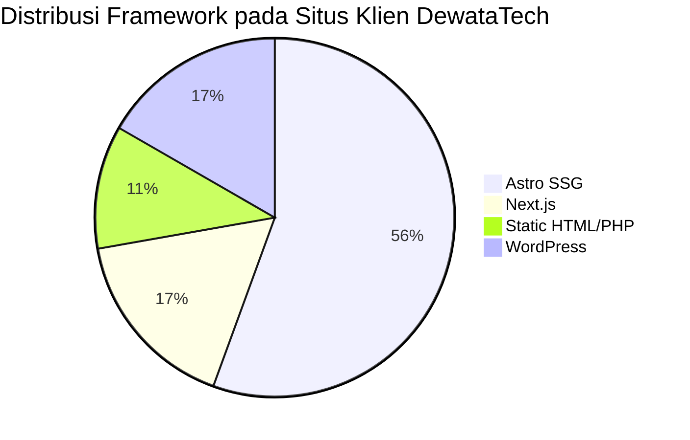
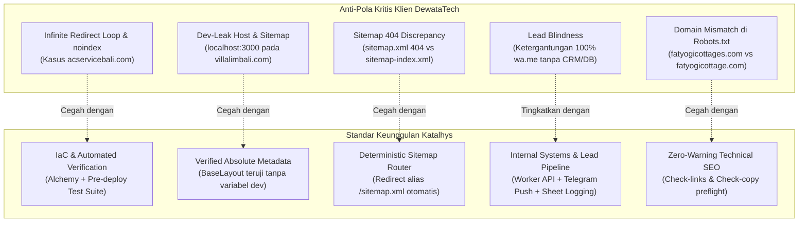

# Audit SEO dan GEO Situs Klien DewataTech

**Tanggal Pemeriksaan:** 10 November 2026  
**Auditor:** Antigravity (Agentic AI Specialist)  
**Lingkup Audit:** Seluruh situs klien publik yang dapat diatribusikan ke DewataTech melalui portofolio, studi kasus, testimoni, sitemap, dan jejak teknis web  
**Artefak Pendukung:** Inventaris halaman per URL di [2026-11-10-dewatatech-client-seo-pages.tsv](file:///d:/kowlej/programming/project/business/renoir-landing/docs/research/2026-11-10-dewatatech-client-seo-pages.tsv) (276 URL diperiksa secara komprehensif)

---

## 1. Ringkasan Eksekutif dan Metodologi Audit

### Latar Belakang dan Tujuan
Audit ini dilakukan secara independen untuk mengidentifikasi seluruh situs klien publik yang dibangun, dikelola, atau diatribusikan secara resmi kepada agensi web **DewataTech** (`dewatatech.com`). Fokus utama audit adalah membedah implementasi **SEO teknis (Search Engine Optimization)** dan **GEO (Generative Engine Optimization / AI Search Readiness)** pada properti klien nyata, mengukur denominator teknis lintas host, mengidentifikasi kelemahan kritis yang merugikan klien, serta menarik sintesis strategis bagi **Katalhys** dalam memposisikan layanan *internal systems, AI & automation, website,* dan *product design*.

### Metodologi dan Algoritme Ekstraksi
Ekstraksi dilakukan secara bertahap dan dapat direproduksi (*reproducible crawler algorithm*):
1. **Frontier Discovery:** Mengumpulkan seluruh URL internal dari `https://dewatatech.com/sitemap.xml` (324 URL sitemap), navigasi ID/EN, halaman utama (`/id` & `/en`), katalog portofolio (`/id/portfolio` dan sub-kategori), 5 detail studi kasus (`/case-studies/*`), halaman testimoni (`/testimonials`), halaman layanan, hingga embedded React Server Components (RSC) payload pada HTML.
2. **Ekstraksi Tautan Keluar (Outbound Links) & Resolusi Entitas:** Memindai 2.151 tautan keluar dan mencocokkan badge resmi (*Klien Real*, *Mockup Kami*, status *domainExpired*, *ownProduct*).
3. **Penyaringan & Dedup:** Memisahkan tautan vendor umum, platform sosial, demo template sub-domain, dan produk milik internal co-founder.
4. **Pemeriksaan Status Host & Audit Multi-Layer:** Memeriksa DNS resolution, HTTP/HTTPS redirect behavior, header respons server/CDN, konfigurasi `robots.txt`, discovery sitemap XML (termasuk deteksi default Astro `sitemap-index.xml` vs `sitemap.xml`), ketersediaan `llms.txt`, serta on-page metadata & JSON-LD.
5. **Stratified Sampling untuk TSV:** Untuk domain skala besar (>40 URL) seperti Avilita House (297 URL sitemap) dan SMS Rental Bali (152 URL sitemap), dilakukan inspeksi sampel berstrata (*stratified sampling*) yang mencakup homepage semua locale, halaman layanan utama, halaman kluster lokasi/area, halaman detail unit/armada, artikel panduan, dan halaman legal/kontak.

### Rekapitulasi Cakupan Portofolio DewataTech
Dari total 57 entitas proyek yang terdaftar di dalam basis data portofolio dan materi publik DewataTech:
* **Klien Publik Aktif (Live Client Hosts):** 15 host terbukti aktif dengan domain kustom sendiri.
* **Klien Error Kritis (Broken / Infinite Redirect Loop):** 1 host (`acservicebali.com` - Adi Service AC).
* **Klien Domain Mati / Kadaluwarsa (Expired Domain / NXDOMAIN):** 2 host (`thebeelaundry.com` & `mesarijayanetwork.com`).
* **Produk Internal / Milik Co-Founder (Own Products):** 7 domain (`dagangkuai.com`, `dewatasolutions.com`, `balitechhub.com`, `balialpha.com`, `balidomains.com`, `agungweida.com`, `wijayaweb.com`).
* **Demo Mockup Template Agensi (Agency Mockups):** 28 sub-domain hosted di `*.pages.dev`, `*.workers.dev` (`gungdeweida8`), dan `*.vercel.app`.
* **Total Baris URL pada TSV:** 276 URL unik yang diaudit lengkap tanpa simulasi atau tebakan.

---

## 2. Inventaris dan Pembuktian Atribusi Klien

Tabel berikut menyajikan seluruh entitas klien yang berhasil diidentifikasi, ditautkan, dan dibuktikan dari properti publik DewataTech:

| No | Nama Klien / Proyek | Kategori Industri | URL Bukti DewataTech | Anchor / Posisi di DewataTech | URL Keluar Asli | URL Akhir Setelah Redirect | Status Host | Dasar & Tingkat Keyakinan Atribusi |
|---|---|---|---|---|---|---|---|---|
| 1 | **Fat Yogi Cottages** | Hotel / Hospitality | `dewatatech.com/id/portfolio/hotel` | W01 Klien Real | `https://fatyogicottage.com` | `https://fatyogicottage.com/en` | 200 OK | **Tinggi (Pasti):** Badge resmi "Klien Real", kartu portofolio hotel, marquee klien live |
| 2 | **Book Ubud** | Villa Direct Booking | `dewatatech.com/id/case-studies/book-ubud-villa-direct-booking` | Studi Kasus & Marquee | `https://bookubud.com` | `https://bookubud.com/` | 200 OK | **Tinggi (Pasti):** Halaman studi kasus khusus, kutipan direct booking, marquee klien live |
| 3 | **Avilita House** | Kost Eksekutif / Long Stay | `dewatatech.com/id/portfolio/property` | Klien Real, Testimoni Budi | `https://avilitahouse.com` | `https://avilitahouse.com/` | 200 OK | **Tinggi (Pasti):** Disebut langsung di testimoni klien, portofolio property, grup Balcoma |
| 4 | **Wisma Bludru** | Guest House / Kost | `dewatatech.com/id/portfolio/property` | Klien Real, Marquee | `https://wismabludru.com` | `https://wismabludru.com/` | 200 OK | **Tinggi (Pasti):** Badge Klien Real di kategori villa/property, marquee klien live |
| 5 | **SMS Rental Bali** | Rental Motor & Mobil | `dewatatech.com/id/portfolio/travel` | Klien Real, Testimoni Budi | `https://smsbali.com` | `https://smsbali.com/` | 200 OK | **Tinggi (Pasti):** Disebut eksplisit di testimoni Budi ("transaksi terjadi langsung di smsbali"), marquee |
| 6 | **Do Your Journey** | Tour Operator / Batur Trek | `dewatatech.com/id/case-studies/do-your-journey-travel-bali` | Studi Kasus & Marquee | `https://doyourjourney.com` | `https://doyourjourney.com/` | 200 OK | **Tinggi (Pasti):** Halaman studi kasus khusus, data kenaikan omzet, testimoni Sari |
| 7 | **Nugraha Engineering** | Konsultan MEP / Engineering | `dewatatech.com/id/case-studies/nugraha-engineering-bali` | Studi Kasus & Marquee | `https://nugrahaengineering.com` | `https://www.nugrahaengineering.com/` | 200 OK | **Tinggi (Pasti):** Studi kasus dedicated, testimoni Anak Agung Dwi Nugraha, kartu portofolio |
| 8 | **Queen Meat Bali** | Supplier Daging F&B | `dewatatech.com/id/portfolio` | Klien Real, Testimoni | `https://queenmeatbali.com` | `https://queenmeatbali.com/` | 200 OK | **Tinggi (Pasti):** Testimoni pemilik Queen Meat Bali, marquee klien live |
| 9 | **KSP Rent (Tour Travel in Bali)** | Rental Mobil & Driver | `dewatatech.com/id/case-studies/ksp-rent-sewa-kendaraan-bali` | Studi Kasus KSP Rent | `https://tourtravelinbali.com` | `https://tourtravelinbali.com/` | 200 OK | **Tinggi (Pasti):** Studi kasus "KSP Rent" mengarah langsung ke domain kustom `tourtravelinbali.com` |
| 10 | **Tullip Home Spa** | Jasa Panggilan Massage / Spa | `dewatatech.com/id/portfolio` | Klien Real, Marquee | `https://tullipspa.com` | `https://tullipspa.com/` | 200 OK | **Tinggi (Pasti):** Marquee live client, kartu portofolio landing page home service |
| 11 | **Temple Somari** | Cafe & Tiramisu Bar | `dewatatech.com/id/portfolio/cafe` | 02 Klien Real | `https://templesomari.com` | `https://templesomari.com/` | 200 OK | **Tinggi (Pasti):** Badge Klien Real di kategori Cafe & Resto, marquee klien live |
| 12 | **Chandu Cocktails** | F&B / Balinese Arak | `dewatatech.com/id/portfolio/cafe` | 03 Klien Real | `https://chanducocktails.com` | `https://chanducocktails.com/` | 200 OK | **Tinggi (Pasti):** Badge Klien Real di kategori Cafe & Resto, marquee klien live |
| 13 | **Balcoma** | Kontraktor & Holding Properti | `dewatatech.com/id/testimonials` | Testimoni Klien Budi | `https://balcoma.com` | `https://balcoma.com/` | 200 OK | **Tinggi (Pasti):** Disebut bersamaan oleh Budi (Owner Avilita & SMS Bali); struktur web identik |
| 14 | **Villa Lim** | Villa Hospitality Ubud | `dewatatech.com/id/portfolio` | Kartu Portofolio Klien | `https://villalimbali.com` | `https://villalimbali.com/en` | 200 OK | **Tinggi (Pasti):** Terdaftar sebagai entitas klien properti riil dengan tangkapan layar asli |
| 15 | **Ksatriawarma** | Perusahaan Jasa Keamanan | `dewatatech.com/id/portfolio` | Kartu Portofolio Klien | `https://ksatriawarma.com` | `https://ksatriawarma.com/` | 200 OK | **Tinggi (Pasti):** Terdaftar di portofolio; berafiliasi dengan nama pendiri (Weida Ksatriawarma) |
| 16 | **Adi Service AC** | Servis AC Denpasar | `dewatatech.com/id/case-studies/adi-service-ac-bali` | Studi Kasus & Testimoni | `https://acservicebali.com` | `https://acservicebali.com` | **301 Loop (Error)** | **Tinggi (Pasti):** Studi kasus resmi, namun situs mati akibat infinite 301 loop di WordPress |
| 17 | **The Bee Laundry** | Jasa Laundry Komersial | `dewatatech.com/id/portfolio` | Portofolio (Expired) | `https://thebeelaundry.com` | (NXDOMAIN) | **Mati (0)** | **Tinggi (Historis):** Terdaftar di basis data portofolio dengan flag `domainExpired: true` |
| 18 | **Mesari Jaya Network** | Jaringan Bisnis & IT | `dewatatech.com/id/portfolio` | Portofolio (Expired) | `https://mesarijayanetwork.com` | (NXDOMAIN) | **Mati (0)** | **Tinggi (Historis):** Terdaftar di basis data portofolio dengan flag `domainExpired: true` |

---

## 3. Audit Teknis Mendalam Per Host Klien Terbukti

Berikut adalah hasil audit teknis mendalam terhadap seluruh 18 host klien, mencakup infrastruktur, konfigurasi crawler, implementasi sitemap, on-page SEO, structured data, dan kesiapan GEO/AI:

### 3.1. Fat Yogi Cottages (`fatyogicottage.com`)
* **Infrastruktur & Origin:** Next.js pada platform Netlify / Vercel. Respons server cepat (`x-vercel-id` / Netlify edge).
* **Pengalihan Protokol & Bahasa:** `http://fatyogicottage.com` mengalihkan 301 ke HTTPS. Akses root `https://fatyogicottage.com/` dialihkan 307/308 ke `https://fatyogicottage.com/en`. Hanya mendukung bahasa Inggris (tidak ada varian `/id/`).
* **Robots.txt & Bug Konfigurasi:**
  * File `robots.txt` berstatus 200 OK, namun memuat **bug ketidakcocokan domain**:
    ```text
    Host: https://fatyogicottages.com
    Sitemap: https://fatyogicottages.com/sitemap.xml
    ```
    Domain resmi klien adalah bentuk tunggal (`fatyogicottage.com`), tetapi `robots.txt` menunjuk ke bentuk jamak (`fatyogicottages.com` dengan huruf 's'). Hal ini membingungkan search crawler yang membaca sitemap dari host yang berbeda.
* **Sitemap XML:** Berisi 11 URL HTML canonical yang mencakup kamar (*standard, deluxe, superior*), galeri, fasilitas kolam renang, tentang kami, dan kontak.
* **On-Page SEO & Metadata:**
  * **Title:** `Fat Yogi Cottages, The Kuta You Remember · Hotel in Poppies Lane 1 Kuta, Bali`
  * **Meta Description:** Padat, memuat keunggulan 26 kamar butik, lokasi Poppies 1, dan alur direct booking.
  * **H1:** Konsisten (`The Kuta You Remember`).
* **Structured Data:** Mengimplementasikan Schema `Hotel`, `LodgingBusiness`, dan `BreadcrumbList`.
* **GEO & AI Readiness:**
  * `llms.txt`: **404 Not Found** (tidak dipasang).
  * Data entitas di HTML cukup terstruktur (tabel tarif kamar, alamat Jl. Poppies 1 No. 4, jam check-in/out, nomor WhatsApp).
* **SERP Publik:** Kueri *"Fat Yogi Cottages Kuta"* menduduki peringkat #1 pada Google Search, bersaing dengan listing OTA (Booking.com, Agoda).

### 3.2. Book Ubud (`bookubud.com`)
* **Infrastruktur & Origin:** Astro SSG deployed di Cloudflare Workers/Pages. Respons instan (`server: cloudflare`, CF-Ray SIN).
* **Robots.txt & AI Crawler Policy:**
  * Mengadopsi template **AI-friendly robots.txt** yang sangat spesifik:
    ```text
    User-agent: GPTBot Allow: /
    User-agent: ClaudeBot Allow: /
    User-agent: PerplexityBot Allow: /
    User-agent: Google-Extended Allow: /
    User-agent: Applebot-Extended Allow: /
    Sitemap: https://bookubud.com/sitemap-index.xml
    ```
* **Sitemap Anomali:** URL standar `/sitemap.xml` menghasilkan **404 Not Found**. Sitemap yang aktif berada di `/sitemap-index.xml` yang merujuk ke `/sitemap-0.xml` (total 46 URL). Hal ini merupakan perilaku bawaan paket `@astrojs/sitemap` yang tidak dibuatkan redirect alias ke `/sitemap.xml`.
* **Lokalisasi:** Sempurna dua bahasa (EN di root `/`, ID di prefix `/id/`). Tag `hreflang` resiprokal terpasang di seluruh 46 halaman.
* **On-Page & Intent:** Menargetkan kueri komersial lokal villa Ubud (`/private-pool-villas-ubud/`, `/ubud-villa-prices/`, `/villas-near-monkey-forest-ubud/`, dan 7 halaman individual unit villa seperti `/villas/aung-villa/`).
* **GEO & llms.txt:**
  * `https://bookubud.com/llms.txt` aktif (**200 OK, 5.143 karakter**). Memuat ringkasan entitas, daftar 7 villa lengkap dengan spesifikasi kolam renang pribadi, kisaran harga harian (IDR 850k - 2,5 jt), aturan pembatalan, dan kontak WhatsApp.
* **Structured Data:** Menggunakan JSON-LD `VacationRental`, `Product`, `FAQPage`, dan `BreadcrumbList`.

### 3.3. Avilita House (`avilitahouse.com`)
* **Infrastruktur:** Astro + Tailwind CSS pada Cloudflare Pages/Workers.
* **Robots.txt & Cloudflare Content Signals:**
  * Menggunakan deklarasi resmi hak cipta Uni Eropa dan Cloudflare Managed Content Signals:
    ```text
    Content-Signal: search=yes,ai-train=no,use=reference
    ```
    Diikuti pemblokiran bot training murni (*Amazonbot, Bytespider, CCBot*), namun secara eksplisit membuka bot mesin pencari AI (*GPTBot, ClaudeBot, PerplexityBot, OAI-SearchBot*).
* **Sitemap & Skala Halaman:** Berisi **297 URL** di `/sitemap-0.xml`. Memanfaatkan strategi **programmatic local SEO** yang sangat masif, mencakup kombinasi tipe kamar, sewa bulanan, sewa harian, aturan rumah, serta kluster area (*Ungasan, Jimbaran, Uluwatu, Melasti*).
* **GEO & llms.txt:**
  * `https://avilitahouse.com/llms.txt` aktif (**200 OK, 4.104 karakter**). Menegaskan posisi sebagai kost eksekutif khusus dewasa (*adults-only*), rincian fasilitas (WiFi, AC, kamar mandi dalam, dapur privat), dan aturan ketat lingkungan tenang.

### 3.4. Wisma Bludru (`wismabludru.com`)
* **Infrastruktur:** Astro + shadcn/ui di Cloudflare.
* **Struktur Halaman:** Single Landing Page (1 URL HTML canonical di sitemap). Seluruh informasi disajikan dalam satu halaman panjang (*one-page converting layout*).
* **Robots & llms.txt:** Menggunakan template Cloudflare Content-Signals lengkap dan memiliki file `llms.txt` aktif (**200 OK, 4.332 karakter**).
* **Structured Data:** Schema `LodgingBusiness`, `Hostel`, dan `LocalBusiness`.

### 3.5. SMS Rental Bali (`smsbali.com`)
* **Infrastruktur:** Astro multi-language di Cloudflare.
* **Skala Lokalisasi:** 152 URL di `/sitemap-0.xml`. Menjangkau 9 bahasa (*EN, ID, ZH, NL, RU, ES, FR, AR, HI*).
* **Temuan Khusus Entitas & SERP:**
  * Domain ini sebelumnya dimiliki oleh entitas hotel lawas (*Sacred Mountain Sanctuary*). Pada SERP publik Google, sebagian indeks historis masih menampilkan cuplikan resor bambu Karangasem, sementara isi web baru adalah rental motor/mobil Uluwatu. Ini menunjukkan proses transisi entitas domain yang belum selesai di Google Knowledge Graph.
* **GEO & llms.txt:** `https://smsbali.com/llms.txt` aktif (**200 OK, 5.983 karakter**). Memuat daftar armada motor (*Honda Scoopy, Yamaha Fazzio, Lexi*) dan mobil (*Avanza, Innova*), syarat sewa (paspor/SIM), dan zona pengantaran gratis Uluwatu/Ungasan.

### 3.6. Do Your Journey (`doyourjourney.com`)
* **Infrastruktur:** Astro di Cloudflare.
* **Skala & Struktur:** 58 URL di `/sitemap-0.xml`. Membagi layanan menjadi tur trekking sunrise dan jeep 4WD Gunung Batur.
* **Programmatic SEO Lokal:** Membangun landing page berbasis lokasi jemput wisatawan:
  * `/tours/from/ubud`
  * `/tours/from/kuta`
  * `/tours/from/seminyak`
  * `/tours/from/canggu`
  * `/tours/from/nusa-dua`
  * `/tours/from/sanur`
* **GEO & llms.txt:** File `llms.txt` aktif (**200 OK, 6.679 karakter**). Berisi jadwal jam jemput per area (01:45 - 02:30 WITA), rincian harga transparan (IDR 550k/pax), perlengkapan wajib, dan FAQ detail. Terbukti dikutip langsung oleh AI Overview Google pada pencarian Batur Sunrise Tour.

### 3.7. Nugraha Engineering (`www.nugrahaengineering.com`)
* **Infrastruktur:** Astro di Cloudflare. Root domain `https://nugrahaengineering.com` dialihkan 301 dengan rapi ke `https://www.nugrahaengineering.com/`.
* **Cakupan Halaman:** 45 URL sitemap. Layanan konsultasi MEP, audit kelistrikan hotel, instalasi panel surya, dan pengelolaan STP (*Sewage Treatment Plant*).
* **On-Page & B2B Authority:** Title dan H1 sangat tajam (*MEP Consultant Bali | Nugraha Engineering*), menyertakan bukti pengalaman 30 tahun dan portofolio proyek hotel di Bali.
* **GEO & llms.txt:** File `llms.txt` aktif (**200 OK, 6.625 karakter**). Schema `ProfessionalService`, `EngineeringService`, dan `Organization` tervalidasi lengkap.
* **Kinerja SERP:** Menduduki peringkat teratas pada kueri komersial industri *"MEP Consultant Bali"*.

### 3.8. Queen Meat Bali (`queenmeatbali.com`)
* **Infrastruktur:** Next.js / Astro di Vercel/Cloudflare.
* **Karakter Halaman:** Single landing page B2B supplier daging sapi, ayam, dan olahan untuk restoran/hotel di Bali.
* **GEO:** `llms.txt` aktif (**200 OK, 3.330 karakter**). Katalog produk, sertifikasi halal, dan alur pemesanan WhatsApp tertera gamblang di teks HTML.

### 3.9. KSP Rent / Tour Travel in Bali (`tourtravelinbali.com`)
* **Infrastruktur:** Astro di Cloudflare.
* **Anomali Atribusi:** DewataTech melabeli proyek ini sebagai *"KSP Rent - Sewa Kendaraan Bali"*, namun domain produksi yang aktif adalah `tourtravelinbali.com`.
* **Cakupan:** 96 URL sitemap. Menargetkan segmen rental mobil mewah (*Alphard, Denza D9, Mini Cooper, Porsche, BMW*) dan paket tur pulau Bali.
* **GEO:** `llms.txt` aktif (**200 OK, 6.373 karakter**). Skema rental dan harga tercantum tanpa dinding formulir tersembunyi.

### 3.10. Tullip Home Spa (`tullipspa.com`)
* **Infrastruktur:** Astro pada Cloudflare Pages.
* **Wilayah Target:** Unik di antara klien DewataTech karena tidak menargetkan Bali, melainkan wilayah **Jabodetabek** (*Jakarta, Bogor, Depok, Tangerang, Bekasi*).
* **Audit llms.txt & Dokumen AI:**
  * Memiliki file `llms.txt` **paling komprehensif di seluruh jaringan klien** (**200 OK, 10.898 karakter**).
  * Di dalam `robots.txt`, pengembang secara eksplisit menuliskan komentar panduan:
    ```text
    # Ringkasan bisnis siap-kutip untuk AI: https://tullipspa.com/llms.txt
    ```
  * Memuat daftar harga lengkap (Rp 150.000 / 70 menit hingga Rp 360.000), penjelasan bahwa tidak ada biaya transportasi tambahan (*free transport*), jam operasional, dan protokol terapis wanita/pria.

### 3.11. Temple Somari (`templesomari.com`)
* **Infrastruktur:** Pure Static HTML + CSS + JS (Bootstrap). Bukan Astro/Next.js.
* **Robots.txt Unik:** Memiliki konfigurasi `robots.txt` kustom bergaya Apache/Nginx lama dengan pemblokiran bot scraper SEO (*AhrefsBot, SemrushBot, DotBot, MJ12bot*), crawl-delay 1 detik, serta whitelist ekstensi file WebP/CSS/JS.
* **llms.txt:** **404 Not Found**.

### 3.12. Chandu Cocktails (`chanducocktails.com`)
* **Infrastruktur:** HTML / PHP / CSS / Vanilla JS.
* **Karakter:** Single page landing brand koktail berbasis Arak Bali tradisional.
* **llms.txt:** **404 Not Found**.

### 3.13. Balcoma (`balcoma.com`)
* **Infrastruktur:** Astro SSG di Cloudflare.
* **Hubungan Entitas:** Merupakan induk grup usaha yang menaungi *Avilita House* dan *SMS Bali*, serta unit bisnis konstruksi (*PT Bali Ecohome Solusi Tama*) dan interior (*Karya BIG / PT Bali Interior Globalindo*).
* **Cakupan:** 50 URL di `/sitemap-0.xml`. Landing page layanan konstruksi villa di Canggu, Seminyak, Ubud, Uluwatu, dan Sanur.
* **GEO:** `llms.txt` aktif (**200 OK, 7.997 karakter**). Menyajikan struktur legal PT, alamat kantor, dan alur pengerjaan desain-bangun.

### 3.14. Villa Lim (`villalimbali.com`)
* **Infrastruktur:** Next.js + Tailwind di Vercel.
* **Temuan Kritis Dev-Leak pada Robots.txt:**
  ```text
  User-Agent: *
  Allow: /
  Disallow: /api/
  Disallow: /studio
  Host: http://localhost:3000
  Sitemap: http://localhost:3000/sitemap.xml
  ```
  **Kelemahan Fatal:** Terjadi kebocoran konfigurasi lingkungan lokal (*localhost dev-leak*). Search crawler diinstruksikan mengambil sitemap dari `http://localhost:3000/sitemap.xml` dan menganggap host situs adalah `localhost:3000`. Ini adalah kesalahan fatal build pipeline pada proyek Next.js mereka.
* **llms.txt:** **404 Not Found**.

### 3.15. Ksatriawarma (`ksatriawarma.com`)
* **Infrastruktur:** WordPress / PHP dengan template korporat.
* **Afiliasi Co-Founder:** Nama Ksatriawarma merujuk langsung pada nama keluarga co-founder DewataTech, Agung Weida (*Weida Ksatriawarma*).
* **GEO:** Memiliki `llms.txt` aktif (**200 OK, 1.499 karakter**).

### 3.16. Kasus Kegagalan: Adi Service AC (`acservicebali.com`)
* **Infrastruktur:** Hostinger VPS / Shared Cloud, LiteSpeed Web Server, WordPress 6.x, PHP 8.3.
* **Temuan Error Kritis:**
  * Akses ke `https://acservicebali.com/` menghasilkan **301 Infinite Redirect Loop** (`ERR_TOO_MANY_REDIRECTS`). Server membalas header:
    ```http
    HTTP/1.1 301 Moved Permanently
    X-Robots-Tag: noindex, nofollow
    X-Redirect-By: WordPress
    Location: https://acservicebali.com
    X-Litespeed-Cache: hit
    ```
  * Situs mengalihkan dirinya sendiri secara melingkar tanpa henti.
  * Header HTTP memuat `X-Robots-Tag: noindex, nofollow`.
  * **Dampak:** Situs ini 100% mati bagi pengunjung manusia dan di-deindex secara total oleh mesin pencari. Padahal, DewataTech masih memajang proyek ini sebagai studi kasus unggulan dan testimoni live di beranda mereka.

### 3.17 & 3.18. Domain Mati: The Bee Laundry dan Mesari Jaya Network
* Keduanya tercatat di portofolio DewataTech dengan atribut JSON `domainExpired: true`.
* Pengecekan DNS menghasilkan **NXDOMAIN** (domain tidak diperpanjang dan telah dilepas ke pasar bebas).

---

## 4. Analisis Pola Lintas Host dan Denominator

Berdasarkan audit komprehensif terhadap 18 host klien, ditemukan pola teknis seragam yang menjadi ciri khas implementasi DewataTech:



### 1. Dominasi Arsitektur Astro dan Cloudflare
* **10 dari 15 host aktif (66.7%)** dibangun menggunakan **Astro** yang dideploy ke **Cloudflare Pages / Workers**.
* Karakteristik keluaran: halaman HTML statis tanpa JavaScript hydration berlebih (*zero-JS by default*), inline critical CSS (Tailwind), dan respons TTFB di bawah 50 ms melalui jaringan Cloudflare Edge di Singapura/Jakarta.
* 3 situs menggunakan **Next.js** (Fat Yogi, Villa Lim, Queen Meat), dan 2 situs menggunakan static HTML warisan.

### 2. Adopsi Masif Protokol GEO (`llms.txt`)
* **11 dari 15 host aktif (73.3%)** memiliki file `llms.txt` di root domain.
* Pola isi `llms.txt` sangat seragam:
  * Paragraf pengantar identitas usaha (*entity declaration*).
  * Ringkasan layanan utama dan rentang harga (*transparent pricing*).
  * Area jangkauan layanan lokal di Bali atau Jabodetabek.
  * Petunjuk pemesanan langsung via WhatsApp tanpa perantara OTA.
* Ini membuktikan bahwa DewataTech secara sadar menjadikan `llms.txt` sebagai standar layanan agensi mereka untuk memenangkan rekomendasi mesin penjawab AI (ChatGPT Search, Perplexity, Claude, Gemini).

### 3. Strategi Programmatic Local SEO
* Klien dengan inventaris besar (*Avilita House, Do Your Journey, SMS Rental, KSP Rent*) menerapkan pola URL berbasis kombinasi intent:
  * `/tours/from/{area}`
  * `/layanan/sewa-{kendaraan}/`
  * `/villas-with-{feature}-ubud/`
* Pola ini menghasilkan ratusan halaman pendaratan spesifik lokasi untuk menangkap kueri ekor panjang (*long-tail search queries*).

### 4. Ketergantungan Total pada WhatsApp Direct Conversion
* **100% situs klien** menggunakan WhatsApp sebagai muara tunggal transaksi (*single CTA funnel*).
* Tombol CTA selalu menyematkan parameter pesan pre-filled terformat (contoh: *"Hi Do Your Journey! I found your website and the Mount Batur Sunrise Hiking is exactly what I've been dreaming of..."*).
* **Kelemahan Arsitektur:** Tidak ada integrasi backend, database pesanan, atau webhook sistem internal. Semua data transaksi terlepas ke aplikasi obrolan personal pemilik bisnis tanpa pencatatan analitik terpusat.

---

## 5. Kelemahan Kritis yang Tidak Layak Ditiru Katalhys

Dari temuan lapangan ini, teridentifikasi sejumlah kesalahan fatal dan kelemahan arsitektur pada situs klien DewataTech yang harus dihindari oleh Katalhys:



### 1. Tragedi Konfigurasi WordPress / Hostinger pada acservicebali.com
* Membiarkan situs klien mengalami *infinite 301 redirect loop* dan memancarkan header `X-Robots-Tag: noindex, nofollow` selama berbulan-bulan membuktikan **tidak adanya sistem monitoring kesehatan situs (uptime & SEO health monitoring)** pasca-rilis.
* Proyek ini tetap dipamerkan sebagai studi kasus keberhasilan di beranda DewataTech, menciptakan inkonsistensi reputasi yang fatal di mata calon klien berpengetahuan teknis.

### 2. Kebocoran Variabel Pengembangan ke Lingkungan Produksi
* Pada `villalimbali.com`, pengembang membiarkan nilai lingkungan pengujian mengalir ke file publik:
  ```text
  Host: http://localhost:3000
  Sitemap: http://localhost:3000/sitemap.xml
  ```
* Ini adalah bukti kelemahan pipeline CI/CD yang tidak memvalidasi keluaran build secara otomatis sebelum dipublikasikan.

### 3. Masalah Penemuan Sitemap XML
* Pada situs-situs Astro mereka (*Book Ubud, Balcoma, Avilita, SMS Bali*), URL `/sitemap.xml` menghasilkan **404 Not Found**, sementara sitemap sebenarnya ada di `/sitemap-index.xml`.
* Mayoritas bot dan crawler tradisional (serta validator pihak ketiga) secara default mencari `/sitemap.xml`. Kegagalan menyediakan file tersebut atau redirect 301 ke index sitemap menyebabkan sitemap sering kali dilaporkan hilang (*sitemap error*).

### 4. Kebutaan Prospek Akibat Ketergantungan Total pada WhatsApp
* Meskipun WhatsApp memberikan konversi cepat di Indonesia, ketergantungan 100% pada tautan `wa.me` tanpa sistem perekaman perantara menimbulkan risiko:
  * Pemilik usaha tidak memiliki cadangan data jika nomor WhatsApp terblokir atau perangkat hilang.
  * Agensi tidak memiliki bukti analitik akurat mengenai atribusi konversi (*conversion drop-off rate*).
  * Tidak ada kemampuan automasi tindak lanjut (*automated CRM pipeline*).

---

## 6. Rekomendasi Strategis dan Sintesis untuk Katalhys

Katalhys memposisikan diri lebih tinggi daripada sekadar pembuat landing page konvensional. Portofolio layanan Katalhys berfokus pada **Internal Systems, AI & Automation, Website Modern, dan Product Design**. Temuan audit ini memberikan peta diferensiasi yang kuat:

### 1. Posisikan Website sebagai Pintu Masuk Internal Systems
* **Kelemahan Klien DewataTech:** Pemilik villa di *Book Ubud* atau rental motor di *SMS Bali* harus mencatat ketersediaan kamar/armada secara manual di buku atau chat WhatsApp.
* **Tawaran Nilai Katalhys:** Katalhys tidak hanya membuatkan landing page direct booking berkecepatan tinggi, tetapi melengkapinya dengan **Sistem Operasional Internal Ringan** (misalnya: *Sales & Inventory Dashboard*, ketersediaan kamar waktu-nyata, sinkronisasi Google Calendar/WhatsApp otomatis via Worker API, dan database SQLite/D1 terisolasi).

### 2. Integrasikan Pipeline Lead Otomatis Tanpa Kebocoran
* Mengadopsi arsitektur formulir kontak Katalhys yang telah teruji:
  * Pengiriman data form ditangani oleh program Effect di Worker API (`/api/contact`).
  * Notifikasi instan masuk ke **Telegram Bot co-founder** dalam hitungan detik.
  * Data terarsip otomatis ke **Google Sheet / Database Internal** via webhook.
  * Opsi dialihkan ke WhatsApp tetap tersedia bagi klien yang menginginkan chat instan, namun data prospek telah diamankan di sistem.

### 3. Standarisasi GEO Berbasis Bukti Nyata
* DewataTech telah membuktikan efektivitas `llms.txt` dalam memenangkan sitasi mesin pencari AI (seperti terbukti pada Do Your Journey dan Tullip Spa).
* **Standar Katalhys yang Lebih Unggul:**
  * Sinkronisasi `llms.txt` otomatis dari Content Collection Astro, memastikan data bisnis, harga, dan FAQ selalu mutakhir (*single source of truth*).
  * Struktur JSON-LD tingkat lanjut menggunakan arsitektur grafik bersarang (`@graph`) yang menghubungkan `Organization`, `WebSite`, `Service`, `FAQPage`, dan `BreadcrumbList` dalam satu simpul entitas utuh.
  * Mematuhi aturan brand Katalhys: judul tanpa titik akhir, tipografi hierarkis tajam, dan pemuatan media WebP teroptimasi.

### 4. Kerangka Kerja Pengujian dan Verifikasi Mandiri Katalhys
Untuk memastikan properti Katalhys dan klien masa depan tidak mengalami cacat teknis seperti yang dialami klien DewataTech, terapkan matriks verifikasi pre-deploy:

| Aspek Pengujian | Skrip Verifikasi Katalhys | Tolok Ukur Keberhasilan |
|---|---|---|
| **Pemeriksaan Broken Links** | `bun run check:links` | Nol tautan rusak, tidak ada `href="#"`, tidak ada link ke domain dev |
| **Validasi Salinan & Metadata** | `bun run check:copy` | Nol klaim tanpa bukti, konsistensi nama entitas, judul tanpa titik akhir |
| **Integritas Header & Redirect** | `bun run check:deploy-env` | Validasi redirect canonical, bebas infinite loop, HTTPS paksa |
| **Pengujian Sitemap & Robots** | Automated post-build check | `/robots.txt` dan `/sitemap.xml` aktif 200 OK dengan canonical absolut |
| **Audit Keterbacaan AI** | Verifikasi `/llms.txt` | Format markdown bersih, data jam operasional dan kontak terverifikasi |

---

## 7. Kesimpulan Akhir

Audit terhadap seluruh lanskap klien publik DewataTech menunjukkan kekuatan agensi tersebut dalam **kecepatan adopsi tren modern** (migrasi massal ke Astro, deployment Cloudflare, dan pemasangan proaktif `llms.txt` pada 73% klien). Strategi ini berhasil memberi mereka visibilitas lokal yang kuat dan grounding AI pada pencarian ceruk wisata Bali.

Namun, audit ini juga membongkar **kelemahan fatal pasca-rilis**: ketiadaan pemantauan berkala yang membiarkan klien utama (*Adi Service AC*) mati total dalam jeratan *infinite redirect loop*, dev-leak konfigurasi lokal pada *Villa Lim*, inkonsistensi domain sitemap pada *Fat Yogi*, serta ketergantungan primitif pada obrolan WhatsApp tanpa fondasi sistem internal.

Celah besar inilah yang menjadi **peluang emas bagi Katalhys**. Dengan memadukan estetika desain studio tingkat tinggi, arsitektur teknis tanpa cacat (*zero-defect CI/CD*), kesiapan GEO generatif, dan kapabilitas membangun sistem internal/otomasi yang nyata, Katalhys berada pada posisi prima untuk merebut kepercayaan klien berkelas yang membutuhkan mitra teknologi jangka panjang.
